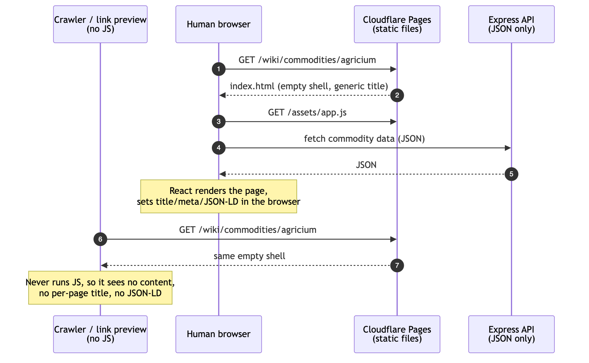
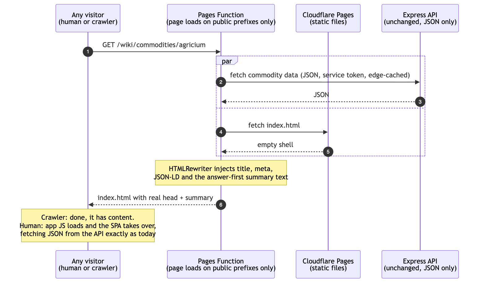
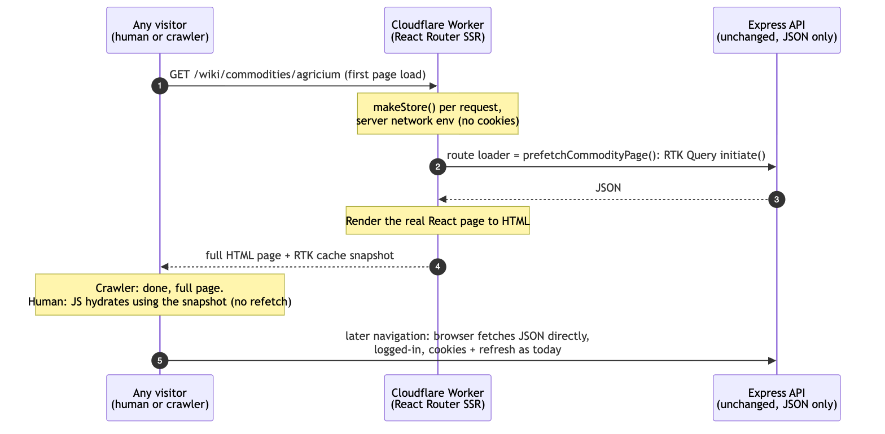
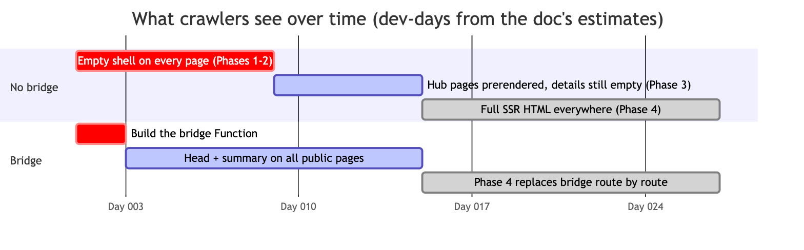
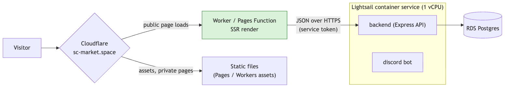
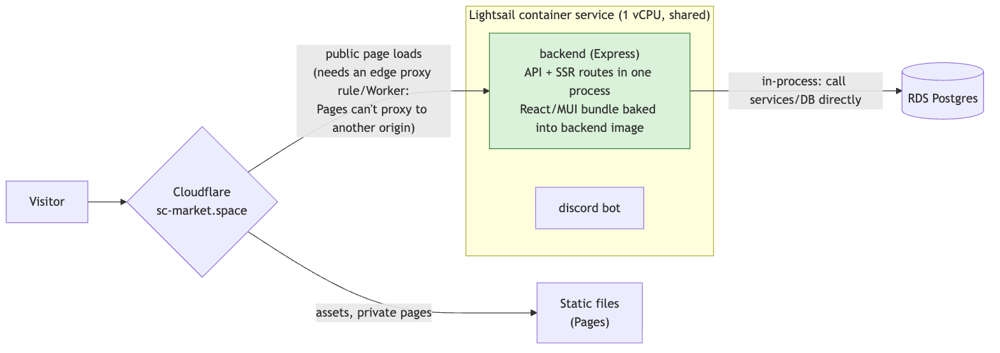
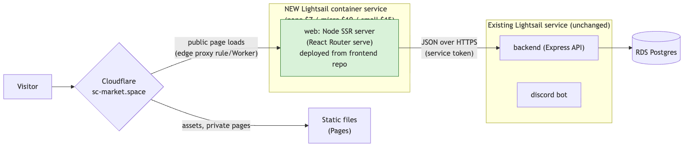
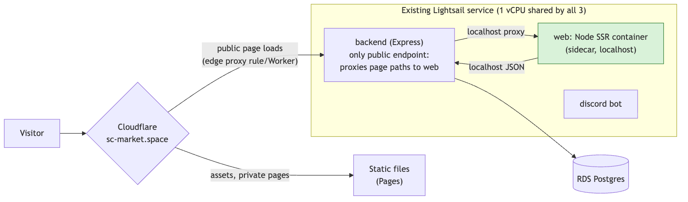
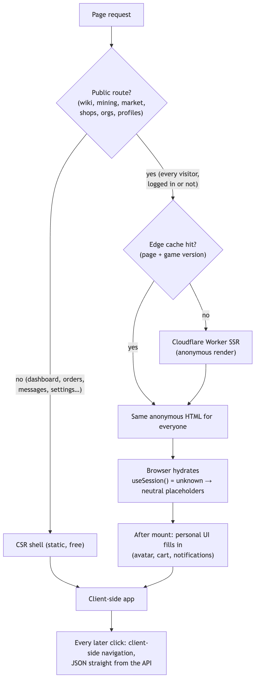

# SSR / Prerender Migration — Design Proposal

Status: Draft for review, assumptions validated 2026-10-23 (see §7) · Scope: `frontend/` (plus backend asks)

**Decided so far:**
- Ship the bridge (§1a). **Done:** live since 2026-10-23, covering the homepage, 14 hubs, entity and game-data detail pages.
- Render on-demand + cache instead of prerendering all game data (§5 Phase 3).
- **SSR runs in a Cloudflare Worker (§1b option A).** Decided 2026-10-24.
- **SSR for every visitor on public routes, with one anonymous, cacheable HTML version, and auth-dependent UI filled in on the client (§1c).** Decided 2026-10-24.

**Pre-work done (on main, 2026-10-23):** single base query with an injectable NetworkEnv + `makeStore()`; per-page prefetch functions (future loaders); single lazy chat socket, call-time browser globals, `useSession()`, `useLocalStorageState`, `useHydrated()`, `useCustomDomain()`; central breakpoint hooks, hydration-safe detail gates and seeded state.

## 1. Summary & recommendation

AI crawlers (GPTBot, OAI-SearchBot, ChatGPT-User, ClaudeBot, Claude-SearchBot, PerplexityBot) and link-preview bots (Discord, Twitter) don't run JS. Googlebot and Bingbot do, but late and expensively. The non-JS bots get the 188-line `index.html` shell with `

` and generic OG tags. All per-page `<title>`, OG and JSON-LD (35 files use `@unhead/react`) is client-only.

**Recommendation: adopt React Router framework mode, phased, with three changes to the brief:**

1. **Target React Router v8, not v7.** v8.0.0 shipped 2026-06-17 (latest is 8.5.0, v7 line ends at 7.18.x). Path: v6.30 → v7.18 with future flags (library mode) → v8 when we enter framework mode. v8 requirements: React ≥ 19.2.7 (we have 19.2.4 installed), Node ≥ 22.22, Vite ≥ 7 for framework mode (we're on 7.3.6). v8 is ESM-only and removes the `react-router-dom` package, which is imported in **315 files**. There's no official codemod; it's a find/replace per the v7 upgrade guide. Before v8 we must adopt v7's `v8_*` flags (`v8_middleware`, `v8_splitRouteModules`, `v8_viteEnvironmentApi`, `v8_passThroughRequests`, `v8_trailingSlashAwareDataRequests`).
2. **Prerender only hub pages; render game-data detail pages on demand and cache them per game version.** Prerendering all ~15.5k game-data pages (live sitemap) doesn't fit: CF Pages allows 20k files per site on Free (100k on paid), builds time out after 20 minutes, everything goes stale every patch, and item pages carry live data anyway (§5 Phase 3).
3. **Runtime SSR is always anonymous.** All auth cookies (`scmarket.sid`, `scmarket.access`, `scmarket.refresh`, `scmarket.cidstate`) are host-only on `api.sc-market.space` (`backend/src/server.ts:194-210`, `api/util/jwt.ts:203-226`: no `domain`, `SameSite=None`). A Worker on `sc-market.space` never sees it. That's fine for SEO (only public pages), and it means no server-side auth work. But we have to remove the hydration mismatches caused by client-only "logged-in" state (§3.4).

Vike, vite-react-ssg and Next.js all lose to RR framework mode for this codebase (§4). If the goal were only crawler visibility at minimum cost, a route-scoped Pages Function is the cheap stop-gap (Option E). It's worth considering as a 2-day bridge while Phases 1-2 land (see §1a).

## 1a. Architecture at a glance

The Express API stays a JSON API in every option. What changes is **who turns that JSON into HTML, and when**.

**Today:** only the browser turns JSON into a page. Crawlers that don't run JS get the empty shell.

**Bridge (decided, ~3–4 days):** a route-scoped Cloudflare Pages Function fetches the page's JSON from the existing API and uses `HTMLRewriter` to inject `<title>`, meta, JSON-LD and the answer-first summary into `index.html`. Every visitor gets the same response. Humans then run the SPA exactly as today. Express renders nothing.

**Target (Phase 4):** a Cloudflare Worker running React Router renders the real React page on the server. Route loaders call the `prefetchXPage(dispatch, params)` functions (branch `worktree-agent-aff73f5281e7e4760`, 11 page types) on a per-request store; the rest of the public routes still need them written. Browsers hydrate from the cache snapshot, then navigate client-side against the API as today.

### Bridge vs no bridge

| | No bridge | Bridge |
|---|---|---|
| Crawlers before Phase 4 | Empty shell for ~2 weeks of dev time (Phases 1–2), then hub pages only (Phase 3) | Real title/meta/JSON-LD + summary text on all public pages after ~3–4 days |
| Crawlers after Phase 4 | Full HTML | Full HTML (the bridge is removed prefix by prefix as SSR covers it) |
| Discord/Twitter link previews | Generic until Phase 3/4 | Correct per-page preview after ~2 days |
| Extra code | None | One Function (~1 file + `_routes.json`), reusing `answerContent.ts` builders (4 page types today; listing/shop/org/user/recruiting/blueprint/mission need head builders); deleted after Phase 4 |
| Express changes | Service token (needed for Phase 3/4 anyway) | Same service token, earlier |
| Cost | — | Measured 0.1–0.3 ms CPU per rewrite (workerd), so Free works: 100k requests/day, 10 ms CPU, 50 subrequests. Every public page load counts, logged-in included. Set **fail open** so over-quota serves the plain shell |
| What it doesn't give | — | Rendered page body beyond the summary; real 404s are possible but need care |
| Risk | Visibility delayed weeks | Small: HTML is the same for humans and bots, so no cloaking question (the summary must be visible); failure falls back to the plain shell |
| Gotchas | — | Function responses skip `_headers`/`_redirects`: set `Cache-Control`, `Link`, CORS in code. Fetch the shell via `env.ASSETS.fetch("/")` (pretty path, not `/index.html`) |

## 1b. Where SSR runs: hosting options

Today the API is one Lightsail container service (`cdk/lib/lightsail-stack.ts`): power `medium` (1 vCPU, 4 GB, $40/mo), `scale: 1`, containers `backend` + `discord`, and **only `backend` has the public endpoint**. Postgres is RDS. The API process also runs background jobs on `setInterval` (`backend/src/tasks/tasks.ts`: search-view rebuilds, auctions, listing expiry).

All four options keep static assets and private pages on Cloudflare. Only **public page loads** change. Cloudflare Pages can't proxy a path to another origin (`_redirects` 200 only takes relative URLs), so options B–D still need a thin edge rule or Worker that forwards page paths to Lightsail.

**A. Edge Worker (current plan):** SSR in a Cloudflare Worker, calling the API over HTTPS.

**B. Fold SSR into the Express API process:** Express gets SSR routes; the frontend build is baked into the backend image.

**C. Separate Lightsail service for SSR:** a small Node SSR container (`react-router-serve`) deployed from the frontend repo.

**D. Sidecar in the existing Lightsail service:** a third container next to `backend`/`discord`, reached via an Express proxy because only one container can be public.

| | A. Edge Worker | B. In Express | C. Separate Lightsail | D. Sidecar |
|---|---|---|---|---|
| Extra infra | Workers Paid ($5/mo) | none | +$7–15/mo service | none |
| CPU for renders | Cloudflare's; no effect on API | **shares the API's single vCPU** with requests + background jobs | its own | **shares the single vCPU** |
| Crawl spike impact on users | none on the API (edge cache absorbs most) | bots slow the API for everyone | isolated | bots slow the API for everyone |
| Data access | HTTPS to API | in-process (fastest; could skip HTTP) | HTTPS to API | localhost |
| Deploy coupling | frontend deploys alone | **frontend release = backend release**; frontend build inside backend image | frontend deploys alone | Lightsail deploys all containers together |
| Failure blast radius | SSR down → fall back to SPA shell | API down → site and API both down | isolated | API down → both down |
| Render limits | Free: 10 ms CPU (MUI pages need 25–50 ms warm) → Workers Paid; 1 s startup, 128 MB memory, 64 MiB bundle | none | none | none |
| Edge caching | built in | Cloudflare cache rule needed | Cloudflare cache rule needed | Cloudflare cache rule needed |
| Bridge reuse | bridge grows into it | bridge thrown away | bridge thrown away | bridge thrown away |

**Decision (2026-10-24): A, the Cloudflare Worker.** C stays the fallback if Worker CPU/startup limits bite in Phase 4.

**Assessment:** B and D put render CPU on the same 1 vCPU that serves the API and runs the background jobs, so a crawler burst degrades the product for logged-in users. They also couple frontend and backend releases. C is the clean "no CPU caps" alternative if the render-cost spike shows MUI pages are too heavy for Workers. A remains the default because it isolates crawl load, caches at the edge, and evolves from the bridge. Pending: render-cost spike results (validation in progress).

## 1c. Decided: one anonymous SSR render for everyone, personal UI on the client

SSR only produces the first page of a visit; every later click is client-side. Public routes are server-rendered for **every** visitor, logged in or not, with the same anonymous HTML:

- **Cacheable:** the HTML never depends on who's asking, so it's edge-cached per page (+ game version for game data).
- **Fast for everyone:** logged-in users also get server-rendered content immediately; only personal chrome (avatar, cart, notifications, org switcher) appears after hydration.
- **Correct hydration:** auth-dependent components read `useSession()`, which is `"unknown"` on the server and during hydration, so they render a neutral placeholder in both and only switch after mount. No logged-out → logged-in mismatch.
- **One rendering path:** no hint cookie, no per-visitor routing, nothing to keep in sync.
- **No server-side auth:** auth cookies stay host-only on the API domain; the renderer never sees or forwards user credentials.

Rejected alternatives:
- *CSR for logged-in users (hint cookie):* two first-load paths to maintain, and slower first paint for the users who use the site most.
- *Personalized SSR:* would need the auth cookie on `.sc-market.space` and credential forwarding through the edge; nothing is cacheable and it adds security surface.
- *User-agent split (bots get SSR):* Google's "dynamic rendering" workaround; not recommended.

## 2. Goals / non-goals

**Goals**
- Real HTML (content, `<title>`, meta/OG, JSON-LD, canonical) for public pages: `/market/:id`, `/market/aggregate/:id`, `/shops/:slug[/:tab]`, `/contractor/:id[/:tab]`, `/user/:username`, `/recruiting/post/:id`, `/wiki/**`, `/mining/**`, `/blueprints/**`, `/missions/**`, `/resources/**`, plus list/hub pages.
- Correct HTTP status for crawlers (404 for unknown listing, not 200 shell).
- Hreflang-ready: per-language crawlable URLs (`?lng=de`, see §3.5).
- Keep data fetching on generated RTK Query endpoints only. No manual endpoints, no parallel fetch layer.
- Keep Cloudflare invocation cost bounded: route-scoped only, never a root `_middleware`.

**Non-goals**
- SSR for authenticated or private routes (dashboard, orders, messaging, admin, settings). They stay SPA.
- Server-side auth/session.
- Changing the service worker. `src/sw.ts` stays push-only with no precache or fetch handler (it purges caches on activate). Nothing in this plan adds a precache.
- Next.js, RSC, MUI 6→9 upgrade.

## 3. Current state (checked in code)

### 3.1 Routing and entry
- `src/App.tsx` (1,300 lines): `createBrowserRouter` at L150, `RouterProvider` at L147. It has 165 `path:` entries and 154 `lazy:` routes, all wrapped in `retryDynamicImport`. No `loader`s and no v7 future flags. Nested relative children sit under `/org/:contractor_id` and `/shop/:shopSlug`, and the only splat is `/*` (L1291), so `v7_relativeSplatPath` is low risk.
- `src/index.tsx`: `createRoot`, `UnheadProvider` (client `createHead` with the titleTemplate), Bugsnag, the `vite:preloadError` handler, and `initPWA()` delayed by 2s.
- `index.html` holds the meta tags, font preloads, an inline stale-chunk guard `` XSS.
  - i18n per request (§3.4) and hreflang alternates via `?lng=`.
  - Loaders throw `404` for missing entities.
  - Each route has a `loader` plus a `clientLoader` that doesn't call `serverLoader`. Client-side navigations then keep using RTK hooks and never hit the Worker (no `.data` invocations).
  - Edge-cache game-data HTML keyed by LIVE game version (Cache API, long TTL). Entity pages get short `s-maxage` + SWR.
  - Backend: a **non-user service identity** for the renderer, so responses stay anonymous (existing `scm_` tokens log in as a user and personalize responses). Use an established mechanism rather than a home-made shared secret, e.g. Cloudflare Access service tokens / mTLS from the Worker to the API, or a dedicated non-user principal in the existing token system. The bridge doesn't need one: v2 has no limiter and v1 is limited per visitor IP. Coordinate with the planned v2 rate-limit floor (`RATE_LIMITING_PLAN.md` H2; v2 has no limiter today). Same-zone Worker subrequests carry the visitor's IP in `CF-Connecting-IP`.
  - Loaders must map v1's 400 for unknown contractors/users to 404 (or fix the backend).
- **Cost (measured):** a realistic MUI page with the real theme takes ~10 ms CPU in local workerd on an M3 Pro, projecting to **25–50 ms warm, 100 ms+ on a cold isolate, 2–2.5× for big listing pages** on Workers. That exceeds Free's 10 ms cap, so **Paid ($5/mo) is required**: 10M requests and 30M CPU-ms included, overage $0.30/M requests and $0.02/M CPU-ms. 1M renders/month at 30 ms fits the included CPU. Bundle: ~2.0 MiB gzip minified (limit is 64 MiB uncompressed since 2026-09-04); the real constraint is **1 s startup** because RR imports every route module at boot (check with `wrangler check startup`). Static assets stay free.
- **Risks:**
  - Hydration mismatches: profile seed, feature flags, theme "system", `useMediaQuery` gates. Watch React 19 recoverable errors in Bugsnag.
  - Worker CPU spikes on huge listing pages.
  - API load from bots crawling 30k+ URLs. Mitigate with edge cache and the crawl-delay in robots.
- **Verify:**
  - The same curl matrix (GPTBot, ClaudeBot, PerplexityBot, OAI-SearchBot, Bingbot, Twitterbot) on `/market/<slug>`, `/shops/<slug>`, `/contractor/<sid>`.
  - `curl -o /dev/null -w "%{http_code}" -A GPTBot …/market/does-not-exist` → `404`.
  - `?lng=de` returns German HTML with `<html lang="de">`.
  - A human UA with the `theme=light` cookie gets the light theme with no flash.
  - Zero hydration errors in Bugsnag over 48h.
  - CF analytics: Worker invocations only on the included prefixes.
- **Rollback:** remove a prefix from `run_worker_first` / `_routes.json`, so it falls back to SPA. A full rollback goes back to the Phase 3 static build.

**Total:** ~26–40 dev-days after validation (Phase 1: 1.5–3, Phase 2: 7–10, Phase 3: 2–4 hubs-only, Phase 4: 12–18, plus the pre-work refactors already in progress). The bridge (3–4 days) runs in parallel and is deleted as Phase 4 covers each prefix.

## 6. Open questions

1. **Bridge or not?** Ship Option E (route-scoped Function + HTMLRewriter, §1a) now for Bing/AI/social, or wait about 4-6 weeks for Phases 1-4?
2. **Cloudflare plan:** which plan is the account on? Phase 4 needs Workers Paid (10 ms CPU cap on Free), and the Pages file limit decides Phase 3's scope. Are you OK moving Pages → Workers static assets?
3. **Bot traffic volume:** do you have CF analytics for current bot document requests to `/market/*`, `/wiki/*`, etc.? That's the main input for the cost estimate.
4. **Backend:** OK to add (a) an SSR/build service token that's exempt from or has a higher anonymous rate limit, and (b) bulk export endpoints for game-data prerender? (Both would be TSOA-generated, so they stay inside the codegen-only rule.)
5. **Per-language URLs:** is `?lng=xx` acceptable as the canonical per-language URL for hreflang, or do you want `/de/...` path prefixes? Path prefixes would double the route table.
6. **Mobile vs desktop gates:** `BlueprintDetailGate` (and similar `useMediaQuery` page/modal swaps) needs one canonical SSR rendering. Should bots always get the full-page detail variant?
7. **Timing:** Phase 2 rewrites the route table and touches `App.tsx` and its 154 lazy routes, so it needs a merge window when no one else has large in-flight changes there.

## 7. Assumptions & validation (2026-10-23)

Five subagents checked this doc against primary sources (vendor docs, npm, the code, the live API, and a render-cost spike in `/tmp/ssr-spike`). Corrections are already applied above; this table records what changed.

| Area | Assumption in the original draft | Result |
|---|---|---|
| Crawlers | Bingbot doesn't run JS | **Wrong.** Googlebot and Bingbot render JS; AI crawlers and link-preview bots don't |
| React Router | v8.0.0 on 2026-06-17, latest 8.5.0; React ≥ 19.2.7, Node ≥ 22.22 | Confirmed. Vite ≥ 7 is framework-mode only; v8 is ESM-only |
| React Router | v6 → v7 flags → v8 | **Incomplete.** v7's `v8_*` flags must be adopted first; no official codemod |
| React Router | Prerender writes `.html` + `.data` per path | `.data` only for routes with a server loader; `__spa-fallback.html` only when `/` is prerendered |
| React Router | SPA mode renders only the root at build time | Once `prerender` is on, **every route module** is imported into the server build |
| Emotion | Per-request cache + extraction, streaming for humans | **Conflict.** Extraction needs a complete render (emotion#2800). Inline Emotion styles do stream, measured at the same CPU |
| PWA | Keep VitePWA if it cooperates | No official RR framework support (vite-plugin-pwa#809 open). Separate `sw.ts` build is the default |
| Cloudflare | Pages limit 20k files per deployment | **Per site:** 20k Free, 100k paid (needs `PAGES_WRANGLER_MAJOR_VERSION=4`) |
| Cloudflare | Build image runs Node ≥ 22.22 | **Wrong.** Default is 22.16; pin with `.node-version`/`NODE_VERSION` |
| Cloudflare | Worker bundle limit 10 MB compressed | **Out of date.** 64 MiB uncompressed since 2026-09-04; startup (1 s) and memory (128 MB) are the real limits |
| Cloudflare | Workers Free 10 ms CPU; Paid $5 with 10M req + 30M CPU-ms | Confirmed |
| Cloudflare | `@cloudflare/vite-plugin` covers SSR + prerender | **SSR only:** prerender and SPA mode aren't supported by the plugin |
| Cloudflare | Cache API for long-tail HTML | Works, but per data center; consider Workers Cache (tiered) and its billing |
| Cloudflare | (missed) | 20-minute build timeout; 50 subrequests per request on Free; `_headers`/`_redirects` don't apply to Function responses |
| Backend | 120 anon req/min limits every SSR fetch | **Wrong for v2:** v2 (game data, listings, shops) has no rate limit today. Same-zone Worker calls are keyed by the visitor IP |
| Backend | One session cookie | Four auth cookies, all host-only on the API domain |
| Backend | Service token = existing API token | **No:** `scm_` tokens log in as a user and personalize responses; SSR needs a non-user service identity via an established mechanism (not a home-made secret) |
| Backend | Unknown entities return 404 | v2 yes; **v1 returns 400** (contractors, users) |
| Backend | ~33k game-data URLs | Cap is 33k; **live is 15.5k** (items truncated at 10k of 11,555). Total sitemap ≈ 57.5k, users are the largest section |
| Backend | 2–3 queries per page | Item page 5; commodity 2; ship/ore/location/blueprint/mission render the browser on desktop |
| Backend | (missed) | No `Cache-Control` on game-data endpoints; anonymous shell fires `/api/profile` + `/api/v2/shops/mine` → 401 → refresh (~3 wasted calls per page today) |
| Frontend | ~10 files need SSR-safety changes | **~18**, including `useFeatureFlag.ts` (crashes every page: L53 outside the try), WhiteLabelAuthGate, WikiManufacturerList, MissionSearch, Sidebar, StandardPageLayout |
| Frontend | One desktop/mobile gate | **Five** detail gates render "browser + modal" on desktop → no entity content in server HTML |
| Frontend | 407 files use RTK hooks; 14 `{ store }` importers; ~100 route wrappers | 290 files; 12 runtime importers + `reducerInjection.ts`; ~45 wrappers + default exports, or ~130 generated |
| Frontend | Sockets are safe | Safe for SSR, but two live connections can happen today (existing bug, fixed on the side-effects branch) |
| Frontend | Theme cookie readable by the Worker | Yes, but `SameSite=Strict`: not sent on arrivals from Google/Discord, so first SSR hit uses the default theme |
| Performance | MUI render > 10 ms; ~50 ms | Confirmed: ~10 ms on M3 Pro locally → 25–50 ms warm, 100 ms+ cold on Workers |
| Performance | Bridge cost | 0.1–0.3 ms CPU per rewrite: fits Free |
| Estimates | 19–28 dev-days | **26–40 dev-days** |

**Outside sanity check (Google AI overview, not authoritative):** consistent with this plan. Two ideas kept: use `api.util.getRunningQueriesThunk()` in tests to assert the prefetch functions cover every first-render query; escape any hand-serialized state. Future option, not planned: MUI's Base UI with zero-runtime CSS would remove Emotion's runtime and the streaming limitation, but it's a full restyle.
